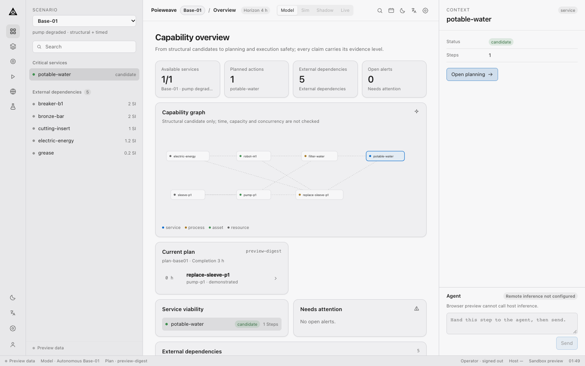
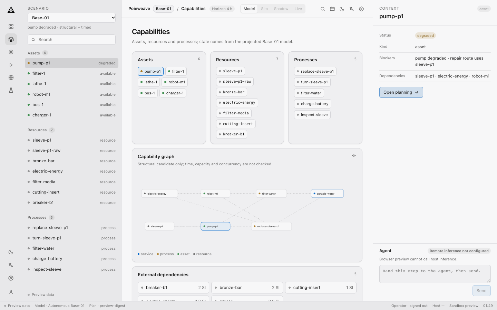
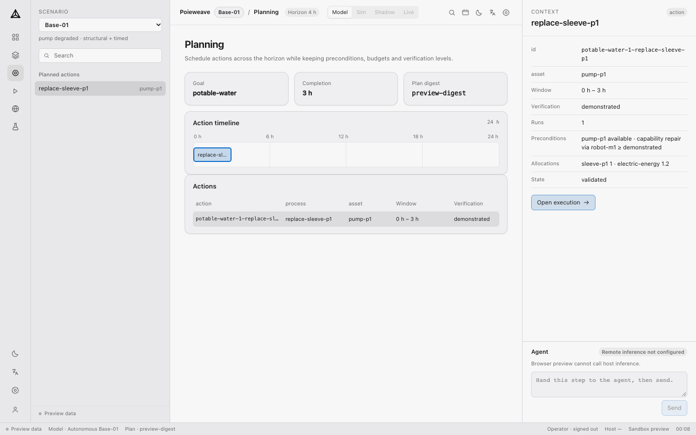
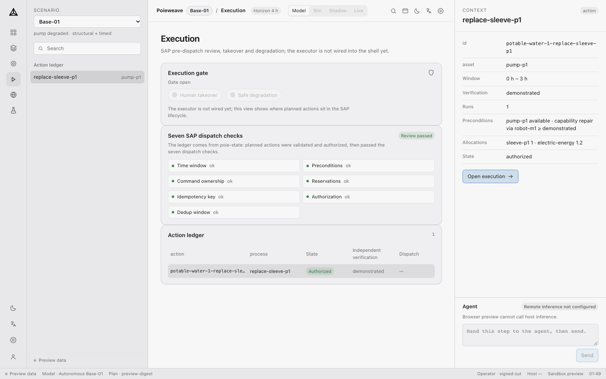
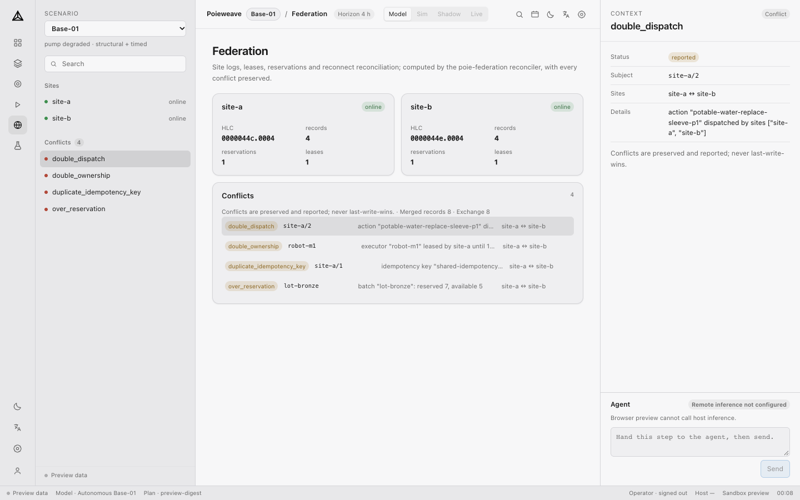
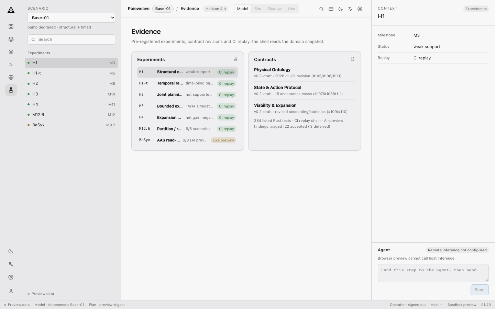
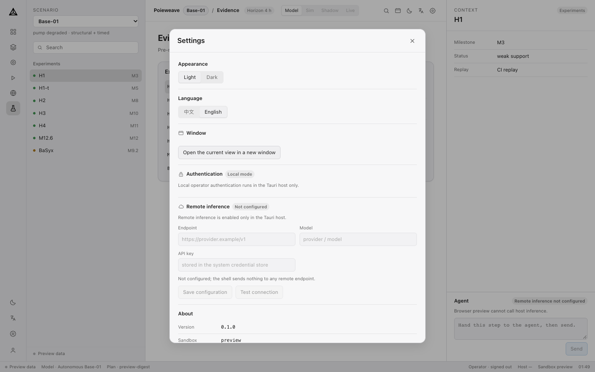
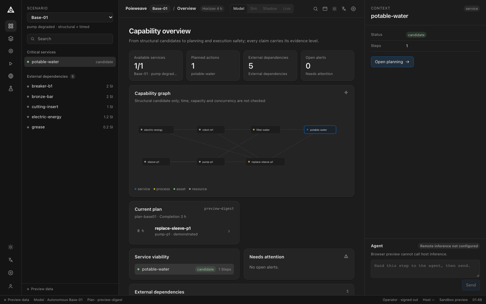
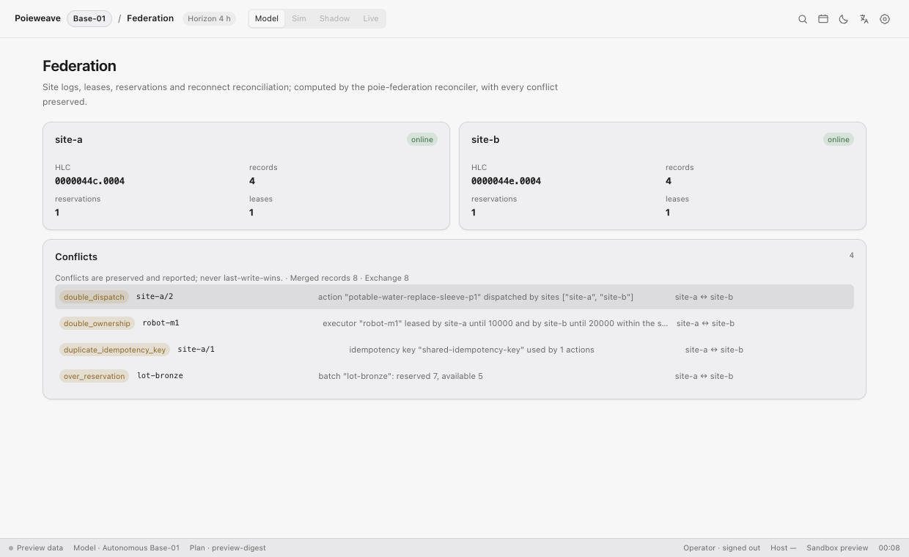

# Poieweave desktop

A Tauri 2 desktop **operations cockpit** for Poieweave: capability graph, planning,
execution gate, federation reconciliation and the evidence chain. The Rust host
owns the app-data directory, SQLite state and a size-limited sandbox; it embeds the
Base-01 model and runs the real `poie-*` domain crates. The frontend is React 19 +
TypeScript + Vite.

## Frontend screenshots (English UI)

| Overview | Capabilities |
| --- | --- |
|  |  |
| **Planning** | **Execution** |
|  |  |
| **Federation** | **Evidence** |
|  |  |
| **Settings** | **Dark theme** |
|  |  |



This is deliberately **not** a notes/workline layout copied from Inceptless. It
keeps the Inceptless light/dark colour tokens, but the information architecture is
Poieweave's: services → capability entities → plan → SAP execution gate →
federation → evidence.

The app icon and the rail mark are generated from
[`src/assets/poieweave-mono.svg`](src/assets/poieweave-mono.svg) (the mono
capability-graph mark). The Dock icon puts the mark on the neutral Poieweave tile
for legibility; the in-app rail uses the raw mono mark and inverts it in dark mode.

## Layout

```
rail        64px   Poieweave mark + section icons + theme/language/settings/account
sidebar    288px   scenario, search, contextual entities / actions / conflicts / experiments
workspace  1fr     topbar (scenario, horizon, run mode) + one of six views
inspector  360px   context for the selected service, entity, action, conflict or experiment
statusbar  26px    host, model, plan digest, sandbox, time
```

Views:

| View | Content |
| --- | --- |
| Overview | KPI strip, capability graph, current plan, service viability, external dependencies, open alerts. |
| Capabilities | Assets, resources and processes from the projected Base-01 model, plus the structural graph and external dependencies. |
| Planning | Goal/completion/digest, action timeline and action table; the inspector keeps preconditions, allocations and verification level. |
| Execution | **`poie-state`** action ledger (validated → authorized), the seven SAP dispatch checks, a **host-driven** execution gate (human takeover / safe degradation) and the deliberate "executor not wired" warning. Gate changes go through `execution_gate_set`, not local UI state. |
| Federation | **`poie-federation`** sites (HLC, records, reservations, leases), exchange counts and all preserved reconciliation conflicts. |
| Evidence | Pre-registered experiments with replay badges, contract revisions and the 417-test evidence summary. |

`open_workspace_window` opens focused secondary windows rather than another full
cockpit: federation uses a wide wall, execution an execution monitor, evidence a
reading window. `?view=<view>&focus=1` hides the rail/sidebar/inspector and keeps
the topbar, view and status bar.

## Theme and i18n

- Light and dark tokens are the Inceptless values: light `#e8e8ea / #f7f7f8 /
  #efeff1 / #d4d4d8 / #1a1a1a / #666 / #0369CC`; dark `#141414 / #1c1c1c /
  #242424 / #2e2e2e / #f2f2f2 / #9a9a9a / #0369CC`.
- Theme and language persist in `localStorage`; the language switch covers the
  shell (Chinese/English), while model ids, process names and evidence labels stay
  in their source language.
- No dark-mode colour is invented outside the token block in `src/styles.css`.

## Domain integration

The host embeds the Base-01 model (`scenarios/base-01/model.toml`), patches
`pump-p1` to `degraded`, and runs the real crates:

- `poie-ontology`: graph solve per service + external dependency report;
- `poie-plan`: a 24 h plan for `potable-water` with a 4 h deadline;
- `poie-state`: plan actions become SAP `Action`s, are added to an `ActionLedger`,
  moved to `validated` → `authorized`, and reviewed with `review_dispatch` (all
  seven checks);
- `poie-federation`: two sites exchange logs, then `reconcile` reports duplicate
  idempotency keys, double dispatch, over-reservation and overlapping leases.

Snapshots are computed once at host startup and exposed as serializable commands:

```text
domain_overview       scenario, counts, assets/resources/processes, services,
                      plan, externalDependencies
execution_snapshot    SAP actions with idempotency keys and states, seven checks,
                      review status/rejections
federation_snapshot   sites, conflicts, merged records, exchange counts
```

The browser-only `pnpm dev` build uses the same-shaped preview snapshots in
`src/domain.ts`; the Tauri build replaces them with host results. There is no SQL,
solver, ledger or reconciler access from the webview.

## Host commands

| Command | Purpose |
| --- | --- |
| `host_info` | Version, app-data dir, DB path, sandbox root, platform. |
| `domain_overview` | Base-01 snapshot from `poie-ontology` + `poie-plan`. |
| `execution_snapshot` | `poie-state` ledgers + seven dispatch checks. |
| `execution_gate_set` | Host-side takeover/degraded gate; recomputes the execution snapshot and audits the change when signed in. |
| `federation_snapshot` | `poie-federation` exchange/reconcile snapshot. |
| `auth_status` / `auth_register` / `auth_sign_in` / `auth_sign_out` | Local operator session. |
| `audit_list` | Audit events (requires sign-in). |
| `inference_status` / `inference_configure` / `inference_forget` / `inference_test` | Remote inference settings and OpenAI-compatible test call. |
| `sandbox_read` / `sandbox_write` / `sandbox_root` | Relative-path, 1 MiB-limited access under `<app-data>/sandbox`; traversal and absolute paths rejected. |
| `open_workspace_window` | Opens a focused secondary window for one of the six views. |

## Host boundary

Every command goes through the Rust host; the webview never receives SQL or the
sandbox root path except through `host_info`/`sandbox_root`. Path traversal,
absolute paths and oversized files are rejected in `src/sandbox.rs`.

SQLite now contains only the operator, audit and inference-configuration tables;
the earlier demo `notes`/`events` tables are dropped and their commands removed.

## Local authentication

The desktop app supports a **local operator**, not a remote account service:

- first run creates a display name + passphrase; only a salted PBKDF2-HMAC-SHA256
  verifier (210,000 iterations) is stored in SQLite, never the passphrase;
- sign-in creates an eight-hour session held **in the Rust host process only**; the
  webview never receives a session token;
- local operator identity is required to change inference settings or invoke
  remote inference;
- every register / failed sign-in / sign-in / sign-out / inference event is written
  to the `audit` table and shown in Settings (last events).

This is a real device-local lock, not multi-user or federated identity. OIDC /
SSO is deliberately not faked.

## Remote inference

Remote inference is opt-in and unavailable until a signed-in operator configures it:

- endpoint, model and API key are entered in Settings; the endpoint must be HTTPS
  (HTTP is accepted only for loopback testing);
- the API key goes to the platform credential store — **macOS Keychain**,
  **Windows Credential Manager** or **Linux Secret Service** (`secret-tool`) — or
  to the `POIEWEAVE_INFERENCE_API_KEY` environment variable for headless use; it
  is never written to SQLite or to the frontend;
- configuration is stored in SQLite; the HTTP call is a native OpenAI-compatible
  `/chat/completions` request through `ureq` + rustls with the platform
  certificate verifier, so there is no system `curl` dependency;
- the inspector has an **Agent** panel for sending a prompt in the current
  work context; Settings keeps the configuration/test surface. Only explicit
  prompts are sent, and request/response metadata (not prompt text) is audited;
- Linux requires `secret-tool` (package `libsecret-tools`); when it is absent the
  host returns an explicit error rather than silently storing a key elsewhere.

Host tests cover PBKDF2 registration/sign-in, the credential-store abstraction, the
inference configuration, and a real HTTP POST against a loopback server. Platform
keychain/credential-store paths are not exercised by automated tests because they
require an interactive desktop session; verification is by build + explicit UI
error handling.

## Run and verify

```bash
cd apps/desktop
pnpm install
pnpm tauri dev            # native window
pnpm dev                  # browser-only cockpit with preview data

pnpm exec tsc --noEmit -p tsconfig.json
pnpm build
pnpm test:ui                              # Playwright + installed Chrome
cd src-tauri && cargo test --offline      # 12 tests: DB, sandbox, domain, execution, federation, auth, inference, HTTP
cd .. && pnpm tauri build --no-bundle
```

### Browser UI smoke tests

`tests/ui/cockpit.spec.ts` (Playwright, system Chrome) checks:

- all six views navigate and render;
- the four-column cockpit and light/dark token values are stable;
- Chinese/English switching leaves no untranslated key fragments;
- Settings opens and keeps auth/inference host-only in browser preview;
- the inspector agent composer is present and disabled without a host;
- focused-window mode hides rail/sidebar/inspector;
- all icon controls have accessible names.

The `Desktop build` workflow runs this suite on Ubuntu and Windows against
Chrome, uploading `playwright-report`/`test-results` when a run fails. Pixel
baselines are intentionally not committed because macOS/Linux/Windows font
rasterization differs; the stable layout/token assertions and view screenshots in
the test report are the cross-platform visual guard.

## Cross-platform builds

The [`Desktop build`](../../.github/workflows/desktop-build.yml) workflow builds on
every push/PR that touches the desktop app, and on `v*` tags:

| Runner | Bundle | Artifact |
| --- | --- | --- |
| `ubuntu-24.04` | `.deb` | `poieweave-desktop-linux-x86_64` |
| `windows-latest` | NSIS `.exe` | `poieweave-desktop-windows-x86_64` |
| `macos-latest` | universal `.app.zip` (x86_64 + arm64) | `poieweave-desktop-macos-universal` |

Both build jobs run the frontend build and the 18 host tests before bundling; separate UI smoke jobs run Playwright on Ubuntu and Windows. The Linux
job installs WebKitGTK 4.1, GTK/AppIndicator and patchelf prerequisites; Windows
uses the runner's WebView2 and Tauri's NSIS bundler. The macOS job installs the
Intel Rust target and builds a lipo-verified universal binary.

Apple signing/notarization is optional and driven by repository secrets
(`APPLE_CERTIFICATE`, `APPLE_CERTIFICATE_PASSWORD`, `APPLE_SIGNING_IDENTITY`,
`APPLE_ID`, `APPLE_PASSWORD`, `APPLE_TEAM_ID`). Without them the CI build uses
`--no-sign` and produces an unsigned app; the release job uploads the zipped app
and refreshes checksums.

On a `v*` tag, the `release` job downloads all platform artifacts, creates the
GitHub Release if necessary, attaches `.deb` / NSIS `.exe` / universal `.app.zip`,
and uploads `SHA256SUMS`.

Local Linux prerequisites (Debian/Ubuntu):

```bash
sudo apt-get install -y build-essential libwebkit2gtk-4.1-dev \
  libayatana-appindicator3-dev librsvg2-dev libssl-dev libxdo-dev patchelf
cd apps/desktop
pnpm install
pnpm tauri build --bundles deb
```

Windows: install Node 22 + pnpm 10, Rust 1.94, and WebView2 (present on Windows
10/11); then `pnpm install` and `pnpm tauri build --bundles nsis`.

The desktop crate is excluded from the root Cargo workspace, so the existing
Rust CI and `scripts/verify-all.sh` do not require WebKit.

## Next

1. Add macOS CI builds (including Intel/universal) and signing/notarization.
2. Add site-specific federation windows and an execution monitor window that can
   stay open while the full cockpit changes scenario.
3. Add a host command for replaying an evidence artifact from the desktop shell.
4. Add UI automation/visual regression coverage for the cockpit.
