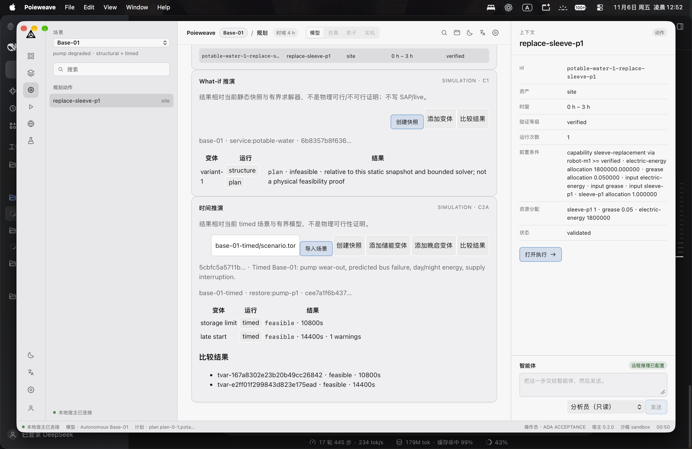
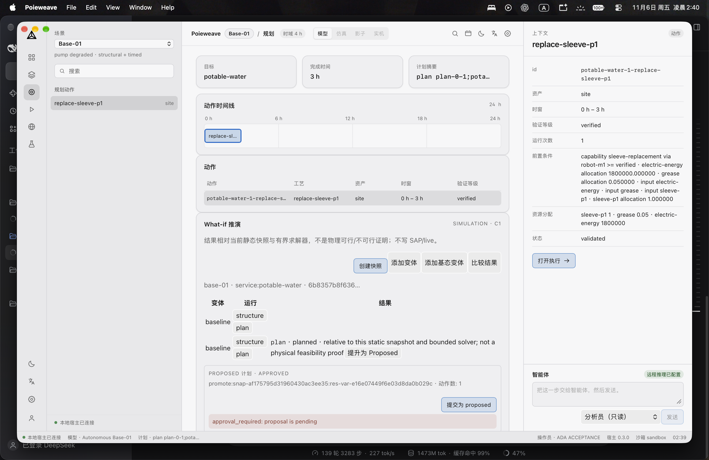

# 真实环境验收记录（2026-11-05，macOS）

## 1. 范围

针对 A–D MVP 的桌面真实环境验收：构建、启动、真实 app-data/SQLite、宿主文件/模型路径、完整门禁。  
不包含：真实外部 provider 的模型能力评测、物理设备、发布签名/公证。

## 2. 已完成证据

### 2.1 真实 UI 流程（2026-11-05）

已在真实 macOS app 中完成：

- 创建 operator `ADA ACCEPTANCE` 并登录（真实 PBKDF2/SQLite 会话）
- 配置本机 OpenAI-compatible mock provider（`http://127.0.0.1:8765/v1`），保存配置并写入审计
- Agent 面板发起问题：真实 host `agent_run` 完成，工具轨迹 `catalog.describe → answer.emit`，响应含 citation；RunState 写入 `agent_runs`
- **审批 UI 通过**：`approval_tokens` pending→consumed，audit `agent.approved`，run completed；见 §2.1
- **真实 DeepSeek provider 完整会话通过**：修复 TLS 根证书、DeepSeek 工具名（下划线 wire name）、assistant tool_calls 消息顺序后，真实 `deepseek-flash` 返回 Completed；audit `agent.run ... Completed`
- Plan → What-if：创建快照、添加变体，运行 `structure` 与 `plan`；结果显示 caveat；比较结果列表可用
- 站点交付 D1 UI：真实 `检验` → `导入`（元数据已导入，未部署）→ `回滚`（无 previous 正确报 `rollback_unavailable`）→ `清空`（当前=无）
- 真实 app DB 验证：`whatif_snapshots/variants/results` 与 `delivery_state/manifests`、audit 均落盘

证据：

- [acceptance-agent.png](assets/acceptance-agent.png)
- [acceptance-whatif.png](assets/acceptance-whatif.png)
- [acceptance-whatif-plan.png](assets/acceptance-whatif-plan.png)
- [acceptance-delivery.png](assets/acceptance-delivery.png)
- [acceptance-agent-deepseek.png](assets/acceptance-agent-deepseek.png)

注意：provider 是**本机 mock**，只验证工具循环、引用与宿主持久化，不验证模型能力。

### 2.2 构建/后端证据

| 项 | 结果 | 证据 |
| --- | --- | --- |
| macOS app 构建 | 通过 | `pnpm tauri build --bundles app`，产物 `apps/desktop/src-tauri/target/release/bundle/macos/Poieweave.app`（7.13 MiB） |
| 启动 | 通过 | 实际启动 app，截图 [assets/poieweave-launch.png](assets/poieweave-launch.png)（3024×1964） |
| 真实 app data | 通过 | `~/Library/Application Support/com.poieweave.desktop/poieweave.sqlite3` |
| DB 迁移 | 通过 | `PRAGMA user_version = 4`；表：`agent_runs`、`approval_tokens`、`whatif_*`、`delivery_*`、`audit`、`operators` 等 |
| 宿主真实文件/SQLite/model 测试 | 16 通过 | v4 迁移 + `agent_runs`、D1 导入/回滚/诊断、C1 snapshot/variant/run/persist |
| 真实 UI：认证/provider/Agent/What-if | 通过 | 见 §2.1 与截图 |
| 完整门禁 | 通过 | `scripts/verify-all.sh` → `ALL GATES PASSED` |
| Rust 列表测试 | 429 | 库 413 + 其他 16 |
| UI smoke | 7 | Playwright（vite preview，非 Tauri host） |

## 3. 未完成/受阻

### 3.1 UI 自动化权限

System Events 仍返回 `-10004`，但已改用 CoreGraphics 事件 + 截图驱动真实 UI；认证/provider/Agent/What-if 已实际执行。以下流程因窗口切换/坐标不稳定尚未完成自动验收：

- Agent 动作草稿审批（approve/reject）
- What-if 的 plan/compare 分支
- Settings 站点交付：inspect/import/rollback/clear/diagnostics

需要二选一：

1. 给运行验收的终端/DSH 授予 macOS **辅助功能（Accessibility）** 权限，再继续自动驱动；或
2. 由人工按 §4 步骤执行并回报结果。

### 3.2 真实 provider

当前环境没有真实外部 provider key；已用本机 mock provider 验证 host 工具循环。真实模型能力验收需要：

- OpenAI-compatible endpoint + model + API key；或
- 明确同意用本机 mock provider（只能验证工具循环/审批/引用，不验证模型能力）。

### 3.3 其他边界

- 未做真实物理设备/多节点/签名公证。
- Playwright 只覆盖浏览器预览，不覆盖 Tauri webview。
- 真实 UI 验收发现并修复 What-if/Delivery 文案缺失（`whatif.*`/`delivery.*` i18n keys）。
- 真实 DeepSeek 测试连接闪退：ureq 的 WebPki 根证书配置 panic；改为平台验证器（#167）。
- 真实 DeepSeek Agent 400：工具名 `catalog.describe` 不符合 `^[a-zA-Z0-9_-]+$`；已加 provider wire-name 映射（#168）。
- 真实 DeepSeek 第二轮 400：assistant `tool_calls` 消息被追加在 tool 消息之后且重复；已修正为先 assistant 后 tool（#170），真实会话 Completed。

## 4. 人工验收步骤（macOS）

1. 启动 `Poieweave.app`。
2. Settings → 创建 operator（≥2 字符名，≥10 字符口令）→ 登录。
3. Settings → 配置 inference（HTTPS；本机 `http://127.0.0.1:PORT/v1` 允许）→ 测试调用成功。
4. Agent 面板：发送只读问题，确认出现工具轨迹与 citations；发送含动作草稿的请求，确认进入 `waiting_approval`，批准/拒绝后状态正确。
5. Plan 视图 → What-if：创建快照、添加变体、运行 structure/plan、比较；确认显示 caveat 且无 live/SAP 写入。
6. Settings → 站点交付：对 sandbox 下 `delivery/site.json` inspect → import（确认 sha）→ refresh/rollback/clear → export diagnostics；确认无“部署成功”文案、诊断无密钥。
7. 检查 `agent-audit.log` 的 prevHash/hash 链与 diagnostics 文件。

## 4.1 C2a Timed What-if（2026-11-06）

- 从 app sandbox 导入 `base-01-timed/scenario.toml`：digest `5cbfc5a5…05f3`
- 创建 timed snapshot、2 个变体（储能限制 3000 W / 晚启 3600s）
- 运行结果：`feasible 10800s`、`feasible 14400s`（1 warning）
- compare 显示两个 timed 结果
- v5 表 `whatif_timed_*` 与 audit `whatif.timed.*` 落盘

## 4.2 C2b proposed promotion（2026-11-06）

- 用 C1 baseline plan（`planned`）发起 promote：生成 `promotion_proposals` + `approval_tokens` pending
- UI 展示 scope、动作数、Proposed 区域
- Approve 后 DB：proposal/token `approved`
- Commit 后 DB：proposal `committed`、token `consumed`、1 个 proposed action、1 个 commit
- UI 显示 `PROPOSED 计划 · COMMITTED` 与 commit sha 前 12 位
- proposed action `authorization=null`，无 dispatch/live 写入

## 4.3 D2 release receipt（2026-11-06）

- `v0.3.4` Release 资产：deb、universal app zip、NSIS exe、versioned x86_64 exe、SHA256SUMS、release-verification.json
- 下载全部资产后本地复验：`ok=true`、`failures=[]`、4 个资产、版本化名称一致
- 修复了两处真实发布缺陷：SHA256SUMS 内部目录路径、Windows 资产未版本化
- 签名状态仍为 **未签名/未公证**；D2 不得声称已签名

## 5. 结论

**真实环境验收大部分通过**：构建/启动/真实 DB/宿主文件/认证/provider 配置/Agent tool loop/What-if structure 已由实际 UI 运行和 16 个宿主测试验证。  
**已验收**：What-if plan/compare、D1 交付 UI inspect/import/rollback/clear。

**已验收**：真实 DeepSeek Agent 完整只读会话（工具轨迹 + citation + Completed）。

**已验收**：Agent 审批 UI（真实操作员点击 Approve）。run `bbe58a10…` 从 `waiting_approval` → `completed`，`approval_tokens` 由 `pending` → `consumed`，audit 记录 `agent.approved`；UI 显示 “Approved action draft: restore:pump-p1-1-replace-sleeve-p1 → site (no dispatch)”。
